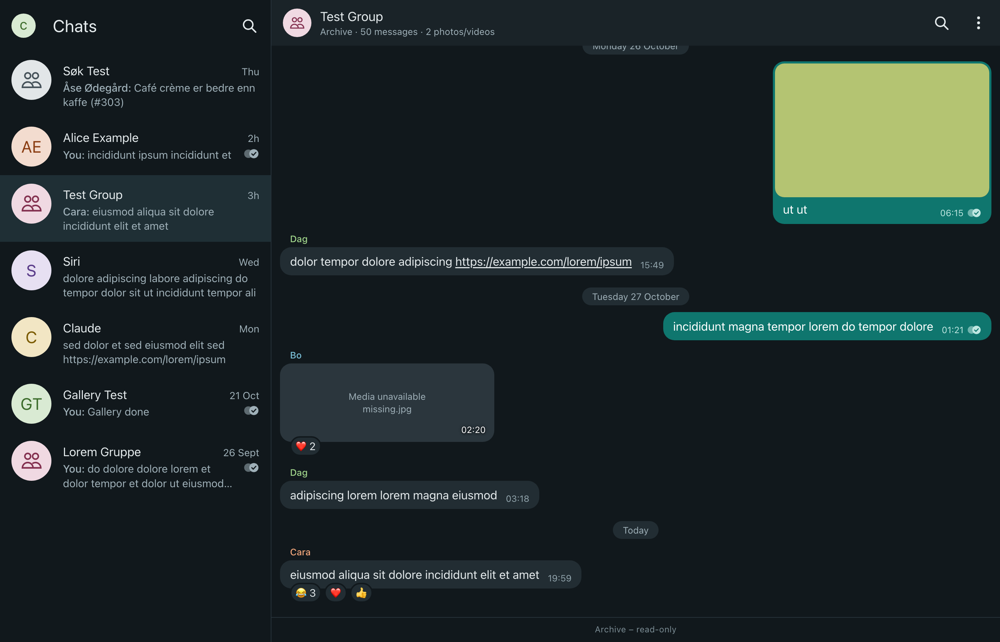
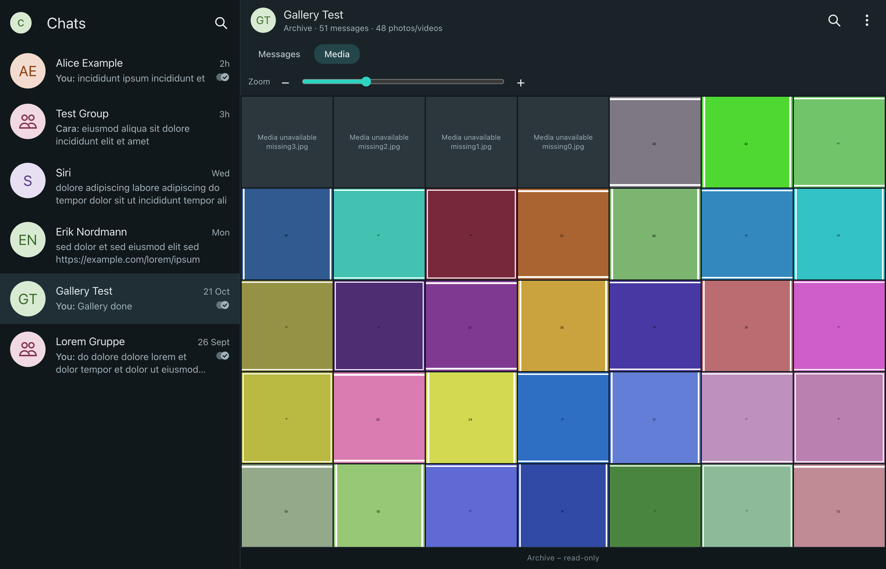
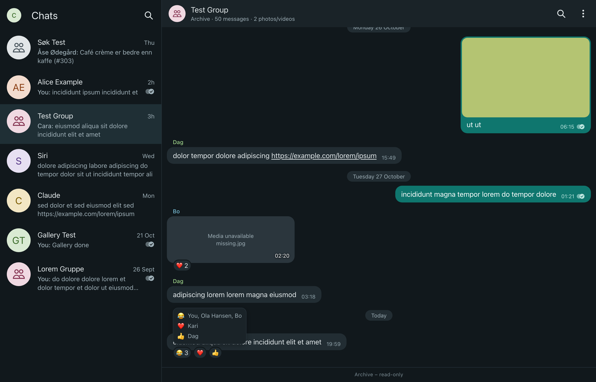
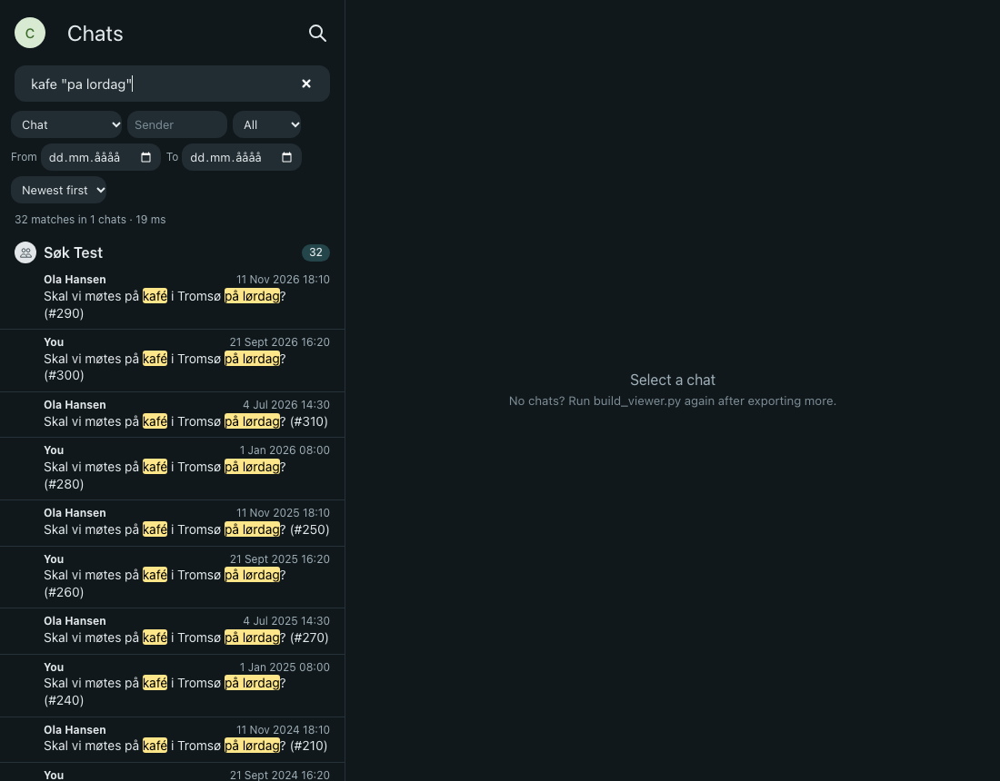
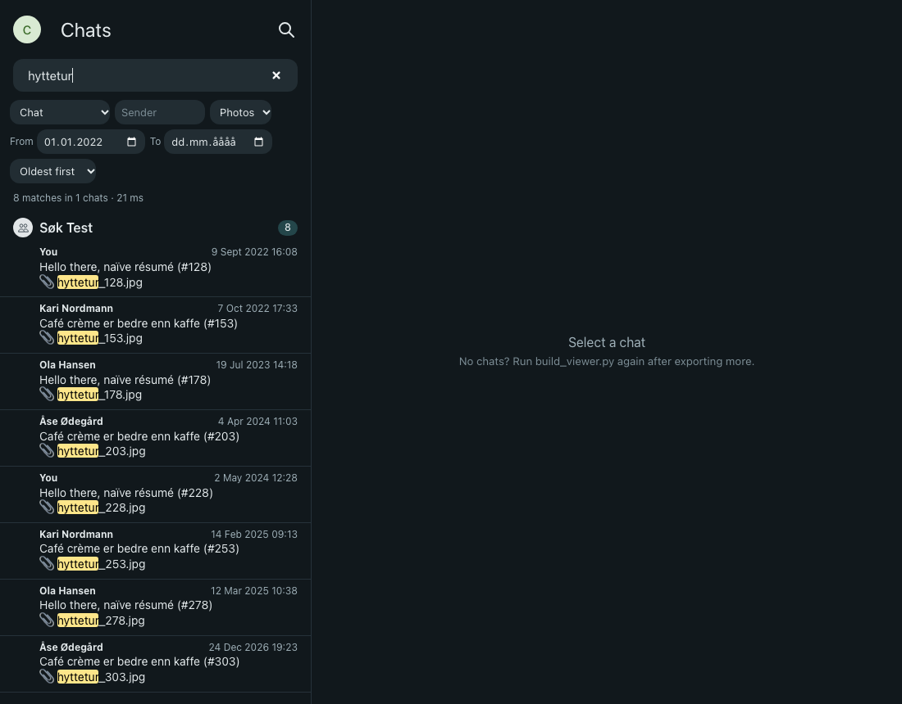
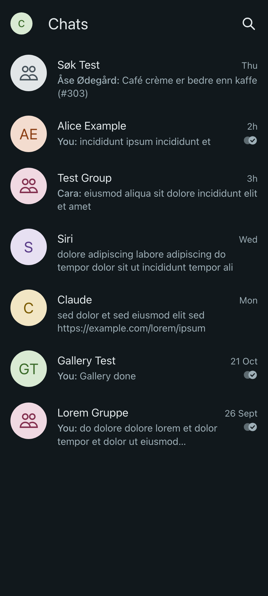

# sigexport-browser

[](https://github.com/phobicdotno/sigexport-browser/actions/workflows/ci.yml)

Offline browser and deduplicated export pipeline for Signal Desktop chats (built on sigexport).

Everyone has experienced the insanely big Signal Desktop folder, but nobody wants to nuke their chat history. Now you can — without losing anything.

sigexport-browser exports every chat, removes duplicate media (a video forwarded to ten chats is stored once and linked from the other nine), verifies every file by hash, and gives you a fast offline chat browser with search and a media gallery.

<p align="center"><a href="docs/screenshots/wide_chat.png"></a></p>

## Real-world result (one user, anonymized)

Measured on a real export after converting it to the central media layout:

| | |
|---|---|
| Chats exported | 33 |
| Raw media written by sigexport | 17.9 GB |
| Duplicates removed | 11.55 GB |
| Media on disk after | 6.0 GB (each unique file once, in `Media/`) |

Earlier estimate from the Signal database for the same account: 35 GiB attachments folder, 19,003 attachment references, ~12.9 GB unique content. Run `tools/measure_duplicates.py` to get your own estimate.

## What you keep / what changes

You keep:
- every message
- every attachment Signal still had on disk
- reactions, quotes and call history

What changes:
- Once you clear Signal's attachments, old media no longer shows inside Signal Desktop. You only see it in the browser.
- The export is a snapshot. Re-run it to pick up new messages.
- Attachments Signal had already lost stay lost. This tool can't recover them.

## Safe order

1. Export (`python3 pipeline/export_all.py`).
2. Verify: the link check must pass, and if you upload a backup, `rclone check --one-way` must report 0 differences (the pipeline runs both for you).
3. Only then clear Signal's attachments.

## Features

**Viewer** (`viewer/`)
- chat list, message bubbles, reactions, quotes, call-history lines
- hover (desktop) or tap (touch) a reaction to see who reacted with which emoji
- Home reset: click the app title or the round avatar at the top left, or press Esc when nothing is open, to close searches, the media tab and the lightbox and jump every chat back to its newest messages
- square media grid with zoom slider, ctrl/cmd + mouse wheel and pinch zoom
- fullscreen lightbox
- global search with filters and jump-to-message
- English and Norwegian (nb) UI, themes via CSS variables
- works from `file://` with no server, and makes no network requests

**Pipeline** (`pipeline/`)
- resumable per-chat export with sigexport (state in `OUT_DIR/_state`)
- md5 media dedup across chats: the first copy wins, and the `chat.md`, `index.html` and `data.json` links of later copies are rewritten to point at it
- link check after dedup; a chat that fails the check is re-exported without dedup. Attachments that sigexport itself reported missing at export time (`missing_kind` set in `data.json`) are left out of the link check, so they don't block dedup, and are counted in the manifest column `missing_reported`
- optional `rclone copy` + `rclone check --one-way` per chat; local exports are never deleted
- stickers are exported once
- disk-space guards (a chat starts only with enough free space, `MIN_FREE_GIB` when there is no size estimate; sigexport is stopped below `ABORT_FREE_GIB` and the chat is queued for retry)
- key-prompt guard: it stops cleanly if sigexport hangs waiting for the OS key store (e.g. the macOS Keychain prompt)
- manifest CSV with per-chat media counts, bytes saved, upload and check status

<table>
<tr>
<td align="center"><a href="docs/screenshots/wide_media.png"></a></td>
<td align="center"><a href="docs/screenshots/reactions.png"></a></td>
</tr>
<tr>
<td align="center"><a href="docs/screenshots/global_desktop.png"></a></td>
<td align="center"><a href="docs/screenshots/global_filters.png"></a></td>
</tr>
<tr>
<td align="center"><a href="docs/screenshots/lightbox.png"></a></td>
<td align="center"><a href="docs/screenshots/list.png"></a></td>
</tr>
</table>

All screenshots use synthetic test data.

## Requirements

- **OS:** macOS, Linux or Windows. The pipeline (`pipeline/export_all.py`, `pipeline/prepare_source.py`, `pipeline/platform_util.py`) is stdlib-only Python with per-OS Signal paths, keep-awake and disk checks, and its unit tests run in CI on ubuntu-latest, windows-latest and macos-latest (Python 3.10 and 3.13). Honest caveat: CI uses synthetic data; real exports of a real Signal account have only been run on macOS 26 so far. Linux and Windows reports are welcome.
- **Python 3.10+** (no third-party packages for the pipeline or the viewer build).
- **[signal-export](https://github.com/carderne/signal-export) (`sigexport`) 3.9.x**, 3.9.3 or newer, installed with pipx, e.g.
  `pipx install --python python3.13 signal-export==3.9.3`
  (older versions have an attachment-decryption crash). Set `SIGEXPORT` if it is not on `PATH`.
- **Signal Desktop** installed and linked to your phone, with the history you want synced to it.
- **rclone** (optional, only if you set `REMOTE` for the upload).
- **Key store access.** sigexport decrypts Signal's database key through the OS key store:
  - macOS: Keychain. On the first run macOS asks for your password for "Signal Safe Storage"; choose **Allow**. (Homebrew on macOS 26 needs the Command Line Tools: `xcode-select --install`.)
  - Linux: the backend in Signal's `config.json` `safeStorageBackend`: `gnome_libsecret` (needs `secret-tool`, from libsecret-tools) or `kwallet`/`kwallet5`/`kwallet6` (needs `kwallet-query`). Unlock the keyring first. Other backends (e.g. `basic_text`) need sigexport's `--password`.
  - Windows: DPAPI. Run as the same Windows user that runs Signal; the key comes from Signal's `Local State` file, which `prepare_source.py` copies along.
- **Free disk:** a chat with no size estimate only starts with at least `MIN_FREE_GIB` free (default 8 GiB); with an estimate it needs about 1.15 x the estimate plus `ABORT_FREE_GIB` (default 3). Below `ABORT_FREE_GIB` the running sigexport is stopped and the chat is queued for retry. Plan for roughly the raw size of your attachments while exporting (dedup shrinks it afterwards).
- **Viewer:** any modern browser; it opens from `file://` with no server.

## Quick start

```sh
git clone https://github.com/phobicdotno/sigexport-browser.git
cd sigexport-browser

# Windows: use `py` (or `python`) instead of `python3`; paths work the same.

# 1. working copy of the Signal data (quit Signal first; on macOS it is quit for you)
python3 pipeline/prepare_source.py                  # -> ~/SignalExport/_work/src

# 2. optional: estimate the savings
~/.local/pipx/venvs/signal-export/bin/python tools/measure_duplicates.py ~/SignalExport/_work/src

# 3. export everything (resumable: just run it again after an interruption)
python3 pipeline/export_all.py --out ~/SignalExport   # uses _work/src if prepared, else auto-detects Signal
#   optional upload + verification:
#   python3 pipeline/export_all.py --remote myremote:Signal-export

# 4. build and open the browser
cp -R viewer ~/SignalExport/viewer                  # or copy the folder in Explorer
python3 ~/SignalExport/viewer/build_viewer.py      # root = parent folder by default
# open ~/SignalExport/viewer/index.html in a browser (macOS: open, Linux: xdg-open, Windows: start)
```

Settings: `SIGNAL_SRC`, `OUT_DIR` (default `~/SignalExport`), `REMOTE` (empty means no upload), `MEDIA_LAYOUT` (`central`), `MIN_FREE_GIB` (8), `ABORT_FREE_GIB` (3), `TRANSFERS` (2), `SIGEXPORT`, `STATE_DIR`. Each one can also be passed as a flag; see `python3 pipeline/export_all.py --help`. `pipeline/export_all.sh` and `pipeline/prepare_source.sh` are thin POSIX-shell wrappers around the Python scripts.

To personalise the viewer, copy `viewer/config.example.js` to `viewer/config.js`. See `viewer/themes/README.md` for themes.

## Install and usage per OS

The viewer build (`viewer/build_viewer.py`) is plain Python 3.10+ with no dependencies and is tested in CI on Linux, Windows and macOS. The pipeline (Quick start above) runs on all three OSes and auto-detects the Signal Desktop folder; you can also run `sigexport` directly and then build the viewer.

Signal Desktop data folder (auto-detected by the pipeline; pass it to `--src` or `sigexport --source` to override):

| OS | Signal Desktop folder |
|---|---|
| macOS | `~/Library/Application Support/Signal` |
| Linux (deb/rpm/AUR) | `~/.config/Signal` |
| Linux (Flatpak) | `~/.var/app/org.signal.Signal/config/Signal` |
| Linux (Snap) | `~/snap/signal-desktop/current/.config/Signal` |
| Windows | `%APPDATA%\Signal` (`$env:APPDATA\Signal` in PowerShell) |

Quit Signal Desktop before exporting, and work on a copy of that folder if you can.

### macOS

```sh
brew install pipx rclone          # rclone only if you upload
pipx install --python python3.13 signal-export==3.9.3
# export with the pipeline (Quick start above), then:
python3 ~/SignalExport/viewer/build_viewer.py
open ~/SignalExport/viewer/index.html
```

### Linux

```sh
sudo apt install pipx rclone libsecret-tools   # or dnf / pacman; rclone is optional
pipx install signal-export==3.9.3
python3 pipeline/prepare_source.py             # Flatpak / Snap folders are auto-detected
python3 pipeline/export_all.py
cp -R viewer ~/SignalExport/viewer
python3 ~/SignalExport/viewer/build_viewer.py
xdg-open ~/SignalExport/viewer/index.html
```

On Linux, `sigexport` reads the database key from the desktop keyring (GNOME Keyring via `secret-tool`, or KWallet via `kwallet-query`). Unlock it first.

### Windows (PowerShell)

```powershell
winget install Python.Python.3.13 Rclone.Rclone   # rclone is optional
py -m pip install --user pipx; py -m pipx ensurepath   # then open a new terminal
pipx install signal-export==3.9.3
py pipeline\prepare_source.py                          # %APPDATA%\Signal is auto-detected
py pipeline\export_all.py
Copy-Item -Recurse viewer "$HOME\SignalExport\viewer"
py "$HOME\SignalExport\viewer\build_viewer.py"
Start-Process "$HOME\SignalExport\viewer\index.html"
```

Keep the export folder short (for example `C:\SignalExport`). Windows paths over 260 characters break in some tools. The build handles them, but rclone and Explorer may not. Optional upload: `py pipeline\export_all.py --remote myremote:Signal-export` (copies and verifies each chat).

On Windows the database key is unwrapped with DPAPI, so run this as the Windows user that uses Signal.

### Opening the viewer

The viewer is a static page that loads from `file://` without a server or network:

- macOS: `open viewer/index.html`, or double-click it in Finder
- Linux: `xdg-open viewer/index.html`
- Windows: `Start-Process viewer\index.html`, or double-click it in Explorer

Every media path the build writes is relative, `/`-separated and percent-encoded. You can move or copy the whole export folder (with `viewer/` inside it) to another machine or OS and it still works. Rerun `build_viewer.py` after each new export. It swaps the new `data/` and `search/` folders in at the end, so an open viewer never sees half a build.

## Phone backup (Android)

Researched 2026-11-06. sigexport-browser does not read phone backups yet. This section describes the current Signal Android backup format and how to get a copy off the phone safely, using other people's tools.

**Planned (not built yet):** a converter that merges phone-only history (for example messages from before Desktop was linked) into the sigexport-browser archive, with dedup and the central `Media/` layout.

### Old `.backup` files: copy them off first

Signal Android's on-device backups now use the new cross-platform "backup v2" format, unlocked by your 64-character account **recovery key**. The legacy 30-digit-passphrase `.backup` format is effectively gone.

Confirming the new backup setup turns legacy backups off, clears the passphrase and **deletes the existing `.backup` files** (Signal-Android `LocalBackupsViewModel.handleUpgrade`, `BackupUtil.deleteAllBackups`). If you have an old `.backup`, copy it off the phone before you switch. [signalbackup-tools](https://github.com/bepaald/signalbackup-tools) handles legacy backups fully, including `--exporthtml`.

### Backup layout

Under the folder you pick in Signal (from Signal-Android `backup/v2/local/ArchiveFileSystem.kt`):

```
SignalBackups/
   files/<2-hex>/<mediaName>          shared encrypted media
   signal-backup-YYYY-MM-DD-HH-mm-ss/ main, metadata, files
```

### Copy it to a computer

```sh
# enable USB debugging on the phone and accept the prompt
adb pull /sdcard/<folder>/SignalBackups ~/SignalPhoneBackup
```

MTP (for example OpenMTP) works too, but it has been seen to silently drop small files ([signalbackup-tools #382](https://github.com/bepaald/signalbackup-tools/issues/382)). Compare the file count on the phone and on the computer afterwards.

### Decrypt it

- **Messages:** libsignal's [message-backup](https://github.com/signalapp/libsignal/tree/main/rust/message-backup) example decrypts a snapshot to JSON (messages only, no HTML, no media). This command is taken from the libsignal source and has not been verified by us yet:

  ```sh
  git clone https://github.com/signalapp/libsignal && cd libsignal
  cargo run --release -p libsignal-message-backup --features json --example decrypt_backup -- \
    --account-entropy "<recovery key>" \
    --metadata <snapshot>/metadata <snapshot>/main > phone_backup.json
  ```

- **Media:** [Escartem/SignalTool](https://github.com/Escartem/SignalTool) can decrypt `files/`. Decrypted media is zero-padded and must be trimmed ([signalbackup-tools #382](https://github.com/bepaald/signalbackup-tools/issues/382)).
- **signalbackup-tools:** v2 support is in progress (branch `signalbackup-tools_bv2`, "very incomplete" as of 2026-11-02).
- **Export chat history:** some builds have Settings > Chats > Export chat history. It writes plaintext `metadata.json` + `main.jsonl` + `files/` and is gated by a server-side flag. Use it if your phone has it.

### Risks

- The recovery key decrypts **all** your backups. Treat it like a master password, and never paste it into chats, issues or screenshots. If it has been exposed, create a new recovery key in Signal. The new key syncs to linked devices, and older backups then need the old key, so make a fresh backup afterwards.
- "Optimize storage" leaves media out of the backup.
- Messages with disappearing-message timers under 24 hours are not backed up.
- Plaintext exports (JSON, Export chat history) are unencrypted. Store them like the rest of `OUT_DIR`.
- Don't restore a backup that a third-party tool has modified to your phone.

Sources: [signalbackup-tools](https://github.com/bepaald/signalbackup-tools), [signalbackup-tools #382](https://github.com/bepaald/signalbackup-tools/issues/382), [libsignal message-backup](https://github.com/signalapp/libsignal/tree/main/rust/message-backup), [Signal-Android](https://github.com/signalapp/Signal-Android), [Escartem/SignalTool](https://github.com/Escartem/SignalTool), [Help Net Security, 2026-09-30](https://www.helpnetsecurity.com/2026/09/30/signal-encrypted-backups-ios-8-30/), [Signal blog: Introducing secure backups](https://signal.org/blog/introducing-secure-backups/).

## Sync (merge-only re-sync)

`python3 pipeline/sync.py --out ~/SignalExport [--upload] [--dry-run] [--quit-signal]` adds only what is new since the last export: new messages (inserted in date order into data.json and chat.md), new media (central `Media/`), new chats (next free NNN). Existing lines, including `"source": "phone-backup"` ones, are never changed or removed, and attachments that Signal no longer has are ignored. Status: `_state/sync_status.json`, log: `_state/sync.log`, lock: `_state/sync.lock` (exit 75 when busy). `--upload` runs `rclone copy` to `$REMOTE` plus `rclone check --one-way` (never sync/delete).

DB snapshot: by default a live copy while Signal runs (db.sqlite, then the WAL, no -shm; retried until no checkpoint happened during the copy). `--quit-signal` quits Signal, copies and reopens it (used by the nightly job).

One-time key setup for unattended runs (macOS), in Terminal while logged in:

    python3.13 pipeline/sync.py --setup-key

Click **Always Allow** on the "Signal Safe Storage" prompt. This decrypts the SQLCipher key once and stores it in your login Keychain as generic password `sigexport-browser` (account = your user, readable by `/usr/bin/security` without a prompt). The key is passed to sigexport in-process; it is never written to a file or a command line. Unattended runs need the login keychain unlocked (you are logged in; the screen may be locked). To remove: `security delete-generic-password -s sigexport-browser`.

## Media layout

Default (`--media-layout central` / `MEDIA_LAYOUT=central`): every unique file lives once in `OUT_DIR/Media/{Pictures,Videos,Audio,Documents}/` under its sigexport name (stickers go to Pictures). When two different files would get the same name, `_<md5[:8]>` goes before the extension. Every chat links to `../../Media/<Type>/<file>` (URL-encoded in `chat.md`/`index.html`, plain in `data.json`), and per-chat `media/` folders are removed. `STATE_DIR/media_index.tsv` maps md5 to `Media/<Type>/<file>`.

After each chat: a hard-link backup is taken, every file is hashed, and a journal (`_state/central_journal/`) is written. Then new files are moved into `Media/`, links are rewritten, and duplicate copies are deleted. A link check runs (every link that resolved before must still resolve), and the empty `media/` is removed. If the run crashes mid-chat, the next run finishes that chat from the journal or restores the backup. Before exporting, the regenerated `chats.txt` must match the existing `NNN_` folders, otherwise the run aborts.

`--media-layout per-chat` keeps the old layout (see below).

**Disk guard.** sigexport and the encrypted DB expose no attachment sizes, so a chat starts only when free space is at least its size from an earlier run × 1.15 + `ABORT_FREE_GIB`. That size comes from `chat_bytes.tsv` or a migration's `hashes.tsv`. With no history, `MIN_FREE_GIB` (8) is required. A chat that does not fit within `DISK_WAIT_SECS` is skipped and listed in `retry.tsv`. During sigexport, free space is polled every `POLL_SECS` (1.5 s). Below `ABORT_FREE_GIB` (3), sigexport is terminated, the partial folder is removed and the chat goes to `retry.tsv`. State and the prepared DB copy stay under `OUT_DIR` (`_state`, `_work/src`), never in `/tmp`.

## How dedup works (per-chat layout)

After each chat is exported, `pipeline/dedup.py` hashes every file in its `media/` folder with md5. A global index (`media_index.tsv`) maps hash to the first file seen. When a later file has the same hash, and the first copy still exists and still matches, the links in that chat's `chat.md`, `index.html` and `data.json` are rewritten to a relative path such as `../../012_Other/Other/media/video.mp4`. Each file is rewritten atomically, and the duplicate is deleted only after that. A link check then resolves every media link. If any link is broken, the chat is re-exported without dedup.

## Sync

Re-sync pulls messages that arrived after the first export into the archive. The sync engine is `pipeline/sync.py`; this section covers the three ways to start it on macOS. **Sync is merge-only: it adds new messages, media and chats and NEVER removes or rewrites anything already in the archive** (locally or on the remote). Only one sync runs at a time (`_state/sync.lock`, exit code 75 = already running). Progress is in `_state/sync_status.json`, the log in `_state/sync.log`.

Install (idempotent, re-run any time):

```bash
tools/install_sync.sh --out ~/SignalExport --remote myremote:Signal-archive   # --remote optional = adds --upload
```

- **Sync button in the viewer.** A circular-arrows button next to the title, shown only when `viewer/sync_config.js` exists. It calls a small helper (`tools/sync_helper.py`, LaunchAgent `no.phobic.sigexport-browser.helper`, KeepAlive) on `127.0.0.1:8765`, then shows the step and progress every 2 s and ends with "+N messages, +M media". The viewer reloads itself through the build stamp. The helper listens on 127.0.0.1 only, requires the random token from `sync_config.js` in an `X-Sync-Token` header, and accepts only `Origin: null` (file://) or its own origin. `sync_config.js` is local only: gitignored and listed in `tools/upload_excludes.txt` (use it as `rclone --exclude-from`). If the helper is down, the button says so.
- **Dock app.** `~/Applications/Signal Sync.app` (built with `osacompile`, generic icon). It asks the helper to start a sync, or runs `sync.py` directly in the background if the helper is down, and shows a notification at start and when it finishes. To put it in the Dock, open `~/Applications` in Finder (Cmd+Shift+H, then Applications) and drag **Signal Sync** onto the Dock.
- **Daily at 03:00.** LaunchAgent `no.phobic.sigexport-browser.sync` (`StartCalendarInterval` Hour 3, Minute 0) runs `tools/sync_scheduled.sh`, which calls `sync.py --upload --quit-signal`. If the Mac was asleep at 03:00, launchd runs the job once on wake. `man launchd.plist` says: "Unlike cron which skips job invocations when the computer is asleep, launchd will start the job the next time the computer wakes up. If multiple intervals transpire before the computer is woken, those events will be coalesced into one event upon wake from sleep." The run is skipped (and logged) when the Mac is on battery below 30 % (`pmset -g batt`, `MIN_BATTERY`). Log: `_state/sync_scheduled.log`.

### Prune Signal Desktop attachments (opt-in)

`sync.py --prune-signal-days N` (or env `PRUNE_SIGNAL_DAYS=N`, default off) frees disk space **in Signal Desktop on this Mac only**. The installer sets `PRUNE_SIGNAL_DAYS=30` for the helper, the Dock app and the 03:00 job when `--remote` is given (`--prune-signal-days 0` turns it off). Safety rules:

- It runs only after the sync **and** the upload's `rclone check --one-way` both succeeded in the same run. Without `--upload`, after a failed chat, or after a failed upload/check, nothing is pruned.
- Only message attachment files under `attachments.noindex/` whose message is older than N days. Stickers, avatars, drafts, temp, downloads and badges are never touched, nor is a file still used by a newer message, a quote, a preview, or a thumbnail/screenshot.
- Every file must pass all three checks, or it is kept and the reason counted: (1) it decrypts in memory with its `localKey` (HMAC checked; sha256 must equal `plaintextHash` when stored), (2) the plaintext md5 is in `_state/media_index.tsv` and that archive file exists with the same md5, (3) the same file is on the remote with the same md5 (one `rclone md5sum REMOTE/Media` listing per run).
- Verified files are moved to `_work/pruned/<date>/` first; that folder is deleted after the run summary is written. Signal can stay running (the DB is read from a fresh copy).
- `sync_status.json` gets `pruned_files` and `pruned_bytes`; `sync.log` gets the counts, bytes and kept reasons. File names are never logged.
- `sync.py --prune-dry-run` (needs `REMOTE`) runs no sync and no upload; it only reports what would be deleted (default N = 30).

Afterwards Signal Desktop shows those old photos and files as blurred placeholders (it may offer to re-download them while the server still has them). Your phone is not affected, and the archive and remote keep every file.

Check: `launchctl print gui/$UID/no.phobic.sigexport-browser.sync` shows the calendar trigger. Uninstall: `tools/install_sync.sh --uninstall` removes both LaunchAgents, the app and the token; the archive is not touched.

## Privacy

- Everything stays on your machine. The pipeline only reads the Signal folder and writes to `OUT_DIR`.
- The viewer is static HTML/JS. It makes no network requests and loads no CDNs.
- Nothing is uploaded unless you set `REMOTE`.
- Logs and the manifest contain chat names, so keep `OUT_DIR/_state` private. The tools in this repo never print message text.

## Limitations

- Real-world runs so far are macOS 26 only; Linux and Windows are covered by CI with synthetic data, not yet by a real account. Only macOS quits Signal for you (`osascript`); elsewhere quit it yourself.
- The export is a snapshot. New messages need a new run.
- Dedup works on exact bytes. A re-encoded copy of the same video is not detected.
- Large files are hashed in full, so the first run is I/O bound.
- Media that Signal no longer has on disk shows as unresolved in the viewer.

## Disclaimer

Not affiliated with or endorsed by Signal Messenger LLC or the signal-export project.
The export itself is done by [carderne/signal-export](https://github.com/carderne/signal-export). Many thanks to its authors.

## License

MIT, see [LICENSE](LICENSE).
